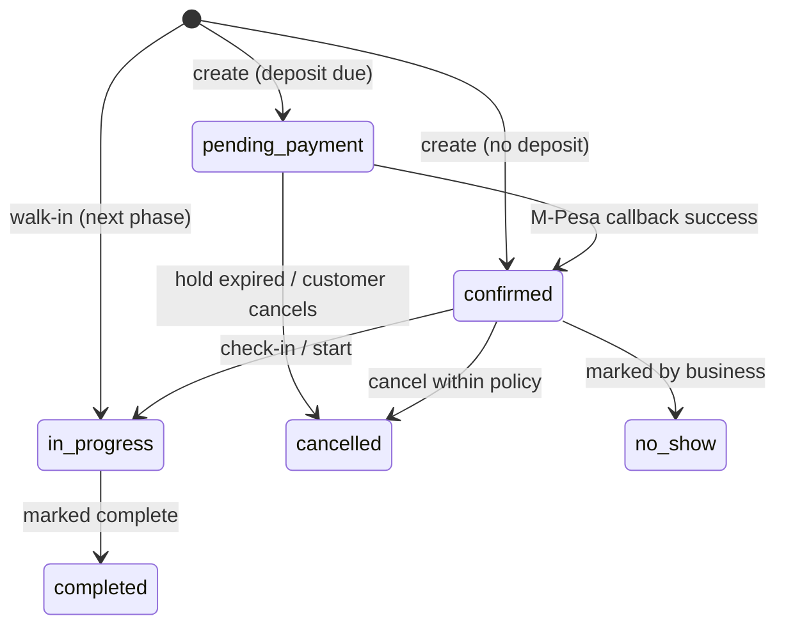
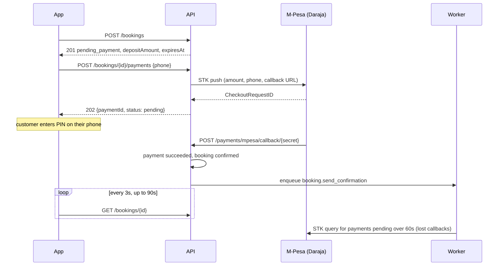

# Booking: implementation plan

Customers can book a real slot and pay the deposit by M-Pesa. The server owns availability, blocks double-bookings and settles the deposit from M-Pesa's callback. This replaces the mocked `create-booking` and `confirm-booking-payment` in the mobile repo's `reference/api/booking.json` (story C2).

- Tasks, owners and status: [BACKLOG.md](BACKLOG.md)
- Frontend contracts: `mobile/reference/api/booking.json`, `fulfillment.json`
- Stories: `mobile/reference/customer.md` (C2, C3, C5), `front-desk.md` (F1, F2), `staff.md` (S1)

## 1. Scope

**This plan (milestones M0–M5)**

- Server-side availability: open slots per staff and day, built from working hours minus existing bookings.
- `POST /bookings` with a conflict check, so two customers can't book the same staff member at the same time.
- Deposits collected by M-Pesa STK push (Daraja), settled by M-Pesa's callback. The app polls for the result.
- Customer booking list and detail, needed as soon as bookings exist.
- A booking confirmation by SMS through the worker.

**Next phase (in the backlog, not designed in detail here)**

- Cancel and reschedule within policy, with the refund or fee outcome (C3).
- Reminders 24h and 2h before (C5).
- Owner and front-desk bookings: walk-ins, booking on a customer's behalf, calendar, status changes (F1, F2, S1, `fulfillment.json`).

**Out of scope**

- The final charge at checkout (`charge-booking`), refunds to M-Pesa (B2C), payouts, retail items, saved styles (C4).

## 2. Current state

Most inputs to booking already exist. The missing pieces are a bookings table, per-staff availability and an M-Pesa client. The app's booking flow runs on mocks (`USE_MOCK_BOOKING`) and computes slots on the phone from working hours only.

| Area | What exists (as of `e8e62bf`) | Gap for booking |
| --- | --- | --- |
| Services | Categories and services with `durationMinutes` and price | No link between staff and the services they perform |
| Staff | `Staff` rows (owner at publish, members when they accept an invite). The roster is `TeamInvitation`, which holds `workingDays` and `commissionPercent` | One person has two ids: the profile returns `Staff.id`, but the app's fulfillment code uses `invitationId` as `staffId`. Working days live on the invitation, not on `Staff` |
| Working hours | Typed Mon–Sun `HH:MM`, one set per business | No timezone, holidays, buffer time or per-staff hours |
| Policies | Deposit fixed or percent, for all or selected services; cancellation and no-show fees | Nothing turns a policy into a deposit amount for a given cart |
| Payments | Payment destination (till, paybill, bank) with format checks; `MPESA_*` keys in `.env` | No Daraja client, STK push or callback endpoint; no passkey setting |
| Notifications | Worker with `emails` and `sms` queues; SMS gateway in `app/modules/auth/sms.py` | No booking notification tasks |
| Customers | Users with email or phone; `/auth/me` | No customer role: any signed-in user can book |
| App | Full C2 flow UI, a `Booking` type with 6 statuses, `useBookingsStore` in memory | Bookings vanish on reinstall; no server list endpoint |

## 3. Decisions

Decided on 2026-09-26 unless marked *proposed*. D3 and D7–D9 are technical proposals that stand unless someone objects in BK-01.

| # | Question | Decision | Why |
| --- | --- | --- | --- |
| D1 | Where does deposit money land? | **Payment routing:** Trimmy's Daraja app sends the STK push, and `PartyB` is the business's own payment destination. A till uses `CustomerBuyGoodsOnline`; a paybill uses `CustomerPayBillOnline` with the account as `AccountReference`; a bank uses its paybill with the bank account as `AccountReference`. Trimmy never holds the money. Based on the `payment-routing-test` prototype (Go). | No custody, so no ledger or settlement to build and no float to manage; it maps onto the destinations businesses already save. **Must be proven in production early (BK-35)**, because the sandbox doesn't check `PartyB`. |
| D2 | M-Pesa environment for development | Daraja **sandbox** until M5; production credentials applied for in parallel (BK-51). | Safaricom's go-live approval takes weeks, so start it early. |
| D3 | Which id is `staffId`? | **`Staff.id` everywhere** (done in BK-02). `workingDays` and commission live on `Staff`; the invitation links to it through `staffId`, set on accept. | Bookings, availability and earnings all key on the person who does the work, and a pending invitee can't be booked. |
| D4 | What does "Any available" mean? | **The booking is left unassigned** (`staffId: null`) and the owner or front desk assigns someone later. The slot is only offered while enough eligible staff remain free to cover every unassigned booking in it. | The owner decides who works on what. Capacity rules are in section 4.3. |
| D5 | Slot rules | 15-minute grid, a booking's length is the sum of its services' durations, 0 buffer by default, 30-minute minimum lead time, bookable up to 30 days ahead. All configurable per business. | The app's current 30-minute grid wastes gaps after short services. |
| D6 | How long does an unpaid booking hold the slot? | **10 minutes** in `pending_payment`, then it's released: status `cancelled` with `cancelReason: "payment_expired"`. | STK prompts time out after about 1–2 minutes, which leaves room for one retry. This keeps the app's 6-status enum unchanged. |
| D7 | Trusting the client's prices | *Proposed:* the server **recomputes** prices, totals and deposit from the database and ignores what the client sends. If the client sends `expectedTotal` and it differs, return 409 `price_changed`. | Otherwise a modified client could book at any price. |
| D8 | Timezone | *Proposed:* each business gets a `timezone` (default `Africa/Nairobi`). Bookings store `startsAt`/`endsAt` in UTC plus the local date and time the customer picked. | Keeps "Monday 09:00" right even if a business outside Kenya ever signs up. |
| D9 | Stopping double-bookings | *Proposed:* a Postgres **exclusion constraint** on each staff member's active assigned bookings, plus a per-business, per-day **advisory lock** around the check and insert (unassigned bookings from D4 can't be covered by the constraint). | Only the database can guarantee this under concurrent requests. |

## 4. Design

### 4.1 Data model

New module `app/modules/booking/` (bookings, availability) and `app/modules/payments/` (M-Pesa, payment records).

| Table | Key columns | Notes |
| --- | --- | --- |
| `bookings` | `id`, `business_id`, `customer_id` → users, `staff_id` → staff (null = unassigned, D4), `source` (`online` \| `walk_in`), `status`, `starts_at`, `ends_at` (UTC), `local_date`, `local_time`, `duration_minutes`, `total_amount`, `currency`, `deposit_amount` (null = none), `payment_status`, `customer_name`, `customer_phone`, `notes`, `expires_at`, `cancel_reason`, `created_at`, `updated_at` | The exclusion constraint on `(staff_id, tstzrange(starts_at, ends_at))` applies while status is `pending_payment`, `confirmed` or `in_progress` |
| `booking_services` | `booking_id`, `service_id` (null if the service is later deleted), `name`, `duration_minutes`, `price_amount`, `quantity` | A snapshot, so editing a service never rewrites past bookings |
| `payments` | `id`, `booking_id`, `kind` (`deposit` \| `charge`), `provider` (`mpesa`), `amount`, `phone`, `destination_type`, `party_b`, `account_reference` (the routing used, copied from the business's payment destination), `status` (`pending` \| `succeeded` \| `failed` \| `timeout`), `checkout_request_id` (unique), `merchant_request_id`, `mpesa_receipt`, `result_code`, `result_desc`, `raw_callback` (JSON) | One row per STK attempt; retries create new rows |
| `staff_services` | `staff_id`, `service_id` | Which services each staff member performs. No rows = all services |
| `booking_events` | `booking_id`, `from_status`, `to_status`, `actor_id`, `reason`, `at` | Audit trail for disputes and the owner's audit-log screen |
| `businesses` (new columns) | `timezone`, `slot_interval_minutes`, `buffer_minutes`, `min_lead_minutes`, `max_days_ahead` | D5, D8 |

### 4.2 Booking states



Every transition goes through one function, `transition(booking, to, actor, reason)`, which checks the move is allowed and writes a `booking_events` row. Nothing else sets `status`.

### 4.3 Availability

`availability.py` is a pure function with no database access, so it can be unit-tested exhaustively:

```
slots(date, business_hours, staff[], bookings[], duration, settings, now) -> [{time, staffIds[]}]
```

1. The day's window is the business's hours for that weekday. A staff member counts only if the weekday is in their working days.
2. Busy blocks are that staff member's active bookings (`pending_payment` not yet expired, `confirmed`, `in_progress`), each widened by `buffer_minutes`.
3. Walk the grid in steps of `slot_interval_minutes`. A start time is offered when some eligible staff member is free for the whole `duration`, the booking ends by closing time, and the start is at least `min_lead_minutes` away.
4. If `staffId` is given, only that staff member counts.
5. **Unassigned bookings (D4)** don't block a specific person, but they use up capacity. For "any available", a start time is offered only if every unassigned booking overlapping it, plus the new one, can be matched to a different eligible staff member who isn't busy with an assigned booking at that time. This is a small bipartite matching problem: at most a handful of staff and bookings per window. A request for a specific staff member must also leave that matching possible.
6. Assigning staff later (BK-26) runs the same check for the chosen person.

`POST /bookings` runs the same function for the requested start time inside the transaction, so availability and booking can't disagree.

### 4.4 Deposit payment flow



- **Routing (D1):** the push is signed with Trimmy's `BusinessShortCode` and passkey. `PartyB`, `TransactionType` and `AccountReference` come from the business's saved payment destination (port the logic from `payment-routing-test/mpesa.go`). `AccountReference` is capped at 12 characters by Daraja.
- **The STK push is called from the request**, not the worker, so the app gets an immediate error for a bad phone number or a Daraja outage. Everything after that is asynchronous.
- **The callback URL** carries a long random secret in its path, plus a check that the `CheckoutRequestID` exists and is still pending. It's idempotent, because Daraja retries. Once in production, restrict it to Safaricom's published IP ranges at the proxy.
- **Result codes** map to what the app shows: `0` success, `1032` cancelled by the user, `1037` or no answer means timeout, `1` insufficient funds, `2001` wrong PIN. Each failure leaves the booking in `pending_payment`, so the customer can retry until `expiresAt`.
- **Reconciliation:** a periodic job runs STK Query on payments still pending after 60 seconds. It resolves lost callbacks and expires dead attempts.

### 4.5 Background jobs

| Job | Kind | Queue |
| --- | --- | --- |
| `booking.send_confirmation` | on event | `sms` |
| `booking.expire_holds`: release `pending_payment` bookings past `expires_at` | every minute | `default` |
| `payments.reconcile_pending`: STK Query for stuck payments | every minute | `default` |
| `booking.send_reminder` (next phase) | scheduled per booking | `sms` |

The worker has no scheduler yet. BK-25 adds a small periodic runner (`python worker.py --beat`, exactly one instance) that enqueues the "every minute" jobs as normal tasks, so any worker can run them.

## 5. API contract

Customer endpoints (Bearer token, any verified user):

| Method | Path | Purpose |
| --- | --- | --- |
| GET | `/businesses/{id}/availability/days?from=&days=14&serviceIds=&staffId=` | Which of the next N days have at least one slot (drives the day strip) |
| GET | `/businesses/{id}/availability?date=&serviceIds=&staffId=` | `{ date, durationMinutes, slots: [{ time, staffIds }] }` |
| POST | `/bookings` | Create; see changes below |
| GET | `/bookings/{id}` | Booking detail, including the latest deposit payment's status (used for polling) |
| GET | `/me/bookings?filter=upcoming\|past\|cancelled` | My Appointments tabs |
| POST | `/bookings/{id}/payments` | `{ phone }` sends the STK push, then returns `202 { paymentId, status: "pending" }` |
| POST | `/payments/mpesa/callback/{secret}` | Daraja only; not in the app contract |

**Changes from the app's `booking.json` (the app team needs to agree to these):**

- **`POST /bookings` request** shrinks to `{ businessId, staffId | null, services: [{ serviceId, quantity }], date, time, notes?, expectedTotal? }`. Names, prices, totals and deposit come from the server (D7).
- **`POST /bookings` response** is the app's `Booking` type plus `expiresAt` and `depositPayment: { status, failureReason } | null`. Errors: `409 slot_unavailable`, `409 price_changed`, `400 validation_error`.
- **`confirm-booking-payment` becomes two calls:** `POST /bookings/{id}/payments`, then poll `GET /bookings/{id}` until `status` is `confirmed` or `depositPayment.status` is `failed`/`timeout`. The app's 402 `payment_failed` and 408 `payment_timeout` become those `depositPayment.status` values, with `failureReason` in `cancelled`, `insufficient_funds`, `wrong_pin`, `timeout`.
- **`staffId`** is `Staff.id` (D3). The profile already returns this; the fulfillment screens need to switch from `invitationId`.

## 6. Milestones

Each milestone ships something the app can switch to, so integration starts early and the mock flags can go one at a time.

| Milestone | Delivers | App can… | Backlog |
| --- | --- | --- | --- |
| **M0 Foundations** | Decisions, staff identity, staff services, timezone and settings, Postgres in CI | — | BK-01 to BK-05 |
| **M1 Availability** | Availability engine and endpoints | Replace `src/utils/availability.ts` with real slots | BK-10, BK-11 |
| **M2 Bookings (no deposit)** | Tables, `POST /bookings`, my bookings, staff assignment, hold expiry, scheduler | Turn off `USE_MOCK_BOOKING` for businesses with no deposit | BK-20 to BK-26 |
| **M3 Deposits (sandbox)** | Daraja client with payment routing, STK push, callback, reconciliation | Run the full C2 flow against the sandbox | BK-30 to BK-36 |
| **M4 Notifications** | Confirmation SMS | Show "we've sent you an SMS" | BK-40, BK-41 |
| **M5 Go-live** | Concurrency test, production M-Pesa, contract hand-off | Ship to real users | BK-50 to BK-52 |
| **Next** | Cancel, reschedule, reminders, owner and front-desk bookings, no-shows | C3, C5, F1, F2, S1 | BK-60 to BK-64 |

M1 and BK-30 (the Daraja client) have no dependency on each other, so two engineers can work on them in parallel once M0 is done.

## 7. How to work on this

- **Pick a task** in [BACKLOG.md](BACKLOG.md): check its dependencies are done, put your name in **Owner** and set **Status** to `in progress` in the same PR as your first commit (or a tiny PR on its own), so nobody else starts it.
- **Branch** `booking/BK-22-create-booking`; reference the task id in the PR title.
- **Where code goes:** `app/modules/booking/` (`models.py`, `schemas.py`, `service.py`, `router.py`, `tasks.py`, `availability.py`), `app/modules/payments/` (`mpesa.py` for the Daraja client, plus `models.py`, `router.py`, `tasks.py`). Tasks auto-register from each module's `tasks.py` (see `app/workers/registry.py`).
- **Follow the existing patterns:** camelCase aliases on schemas, `response_model=` on every route, errors as `{ error, message }`, business logic in `service.py` (routers stay thin), and state changes only through `transition()`.
- **Done means:**
    - tests pass, including the task's acceptance criteria
    - any migration upgrades and downgrades cleanly
    - Swagger shows the real shapes
    - an API change is reflected in `mobile/reference/api/booking.json` (or flagged to the app team)
    - the backlog row is set to `done`

## 8. Risks

| Risk | Impact | Mitigation |
| --- | --- | --- |
| Safaricom production approval is slow (often weeks) | M5 slips | Apply at the start of M0 (BK-51); build and test on the sandbox |
| Production Daraja rejects routing to a `PartyB` Trimmy doesn't own (D1) | The whole deposit model fails at go-live | Prove it with one real third-party till and paybill as soon as production credentials exist (BK-35); the payment-provider interface keeps an aggregator as the fallback |
| Bank account numbers longer than Daraja's 12-character `AccountReference` | Some bank destinations can't receive deposits | Tighten payment-destination validation for banks and tell owners at setup time (BK-36) |
| Deposits land in the business's account, so Trimmy can't refund them itself | Cancellations can't be refunded automatically | Refunds on cancel are done by the business, or deposits become credit; decide in BK-60 |
| Lost or duplicated M-Pesa callbacks | Paid bookings stuck or double-confirmed | Idempotent callback keyed on `CheckoutRequestID`, plus the reconciliation job |
| Double-booking under concurrent requests | Two customers in one chair | Exclusion constraint (D9), a concurrency test (BK-50) and Postgres in CI (BK-05) |
| Timezone and "today" bugs | Wrong slots near midnight or on the current day | Pure availability function with an injected `now`; tests at boundaries |
| The contract change (two-step payment, smaller request) surprises the app team | Integration rework | Share section 5 before M2 starts; BK-52 tracks the hand-off |
